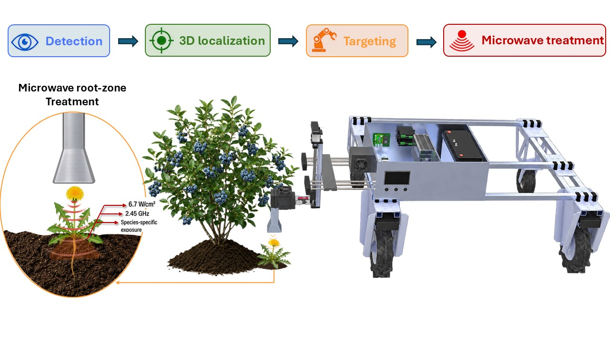
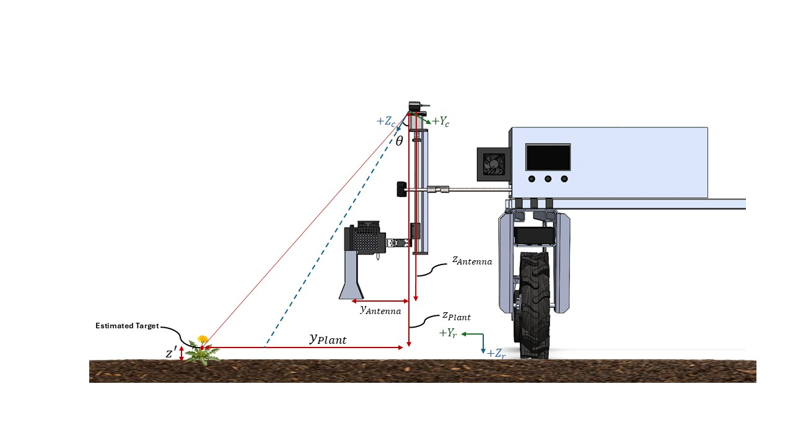

# Vision-Guided Microwave Weed-Management Robot

**Amir Farzinnasab | M.A.Sc. Research | School of Mechatronic Systems Engineering, Simon Fraser University**  
**Supervisor: Dr. Woo Soo Kim**

I developed a mobile robotic platform that combines computer vision, a three-degree-of-freedom positioning arm, and a microwave applicator for targeted weed treatment. The project was motivated by the management of perennial weeds, including dandelion and buttercup, in blueberry production.

My work covered mechanical design, component selection, fabrication and assembly, electrical integration, STM32 firmware, ROS 2 software, and outdoor testing. This portfolio presents the engineering work from CAD development through operation of the assembled robot.

*System concept and intended blueberry-field application. Outdoor prototype testing is shown below.*

## Working Prototype

The RGB-D camera identifies a target weed and estimates its position. The control system then moves the applicator over the target and executes a timed treatment. Manual operation supports positioning and system testing.

*Outdoor testing of vision-guided applicator positioning. These trials evaluated targeting and treatment; autonomous navigation within blueberry rows was outside the demonstrated scope.*

## My Contributions

- **Mechanical design:** Designed the SolidWorks assembly, adjustable chassis, applicator positioning mechanism, mounting components, and sheet-metal horn antenna.
- **Structural analysis and fabrication:** Examined arm-support deflection using finite element analysis and assembled the physical platform.
- **Electronics and embedded control:** Integrated power distribution, motor drivers, sensors, and microwave control; wrote STM32 firmware for motion, manual operation, and treatment timing.
- **Robotics and perception:** Developed ROS 2 software to coordinate YOLO-based detection, RGB-D target localization, robot states, and communication with the STM32 controller.
- **Testing:** Integrated and tested the complete system in the laboratory and outdoors, including experiments to select species-specific treatment durations and evaluate root-tissue damage.

## Mechanical Design

### Chassis and Positioning Mechanism

I designed the robot in SolidWorks around an adjustable aluminum frame with two driven wheels and two caster wheels. The assembly accommodates the battery, inverter, control electronics, camera, and microwave hardware.

The positioning mechanism combines two linear axes with a rotational axis to place the applicator over a detected weed. The design also accounts for component mounting, cable routing, and access during assembly and testing.

*CAD assembly showing the adjustable chassis, drive system, positioning axes, camera, and microwave hardware.*

### Arm Support and Deflection Analysis

The microwave assembly places a load at the end of the extended positioning mechanism. I used SolidWorks Simulation to examine displacement of the support structure under the modeled loading and incorporated cable supports into the fabricated assembly.

*Simulation and physical implementation of the arm-support arrangement.*

### Horn Antenna Design and Fabrication

I designed the microwave waveguide and horn assembly using sheet-metal components, including interlocking edges to support assembly. The figure shows the component drawings, formed geometry, and fabricated applicator.

I also used ANSYS HFSS to examine the electromagnetic behavior of the applicator. The visualization below shows the simulated Poynting-vector distribution, representing electromagnetic energy flow.

## Electronics and Embedded Control

The electrical system connects the battery and inverter with the microwave source, motor drivers, embedded controller, and onboard computer. I integrated the components and developed C firmware for the ARM Cortex-M4-based STM32 controller.

*System wiring diagram showing power distribution, motor drivers, and communication between the controller, onboard computer, and peripherals.*

### Motion and Communication

The controller handles:

- Stepper-motor and servo commands for applicator positioning.
- Wheel-drive commands through I2C-connected DACs.
- UART communication with the Raspberry Pi.
- SBUS radio-controller input for manual operation.
- PWM control of the microwave inverter board and treatment timing.

### Microwave Power and Switching Circuit

The microwave subsystem uses a battery-fed DC-to-AC inverter to supply the microwave inverter board and magnetron. The circuit diagram documents power switching through a contactor and trigger relay, together with the microcontroller connections used to command the microwave source.

*Microwave subsystem power path, protection components, and control circuit.*

## ROS 2 Software Architecture

The Raspberry Pi runs the perception and coordination software, while the STM32 executes motion and treatment commands. I organized the ROS 2 software around three main functions:

| Component | Responsibility |
| --- | --- |
| Weed detection | Process camera images, identify the weed species, and estimate target coordinates. |
| Robot state manager | Coordinate scanning, detection, positioning, and treatment. |
| Communication bridge | Exchange robot states, target data, and acknowledgments with the STM32 over UART. |

The treatment sequence progresses through **Scanning → Detected → Actuating → Treating → Scanning**. This structure coordinates perception with applicator movement and treatment execution.

## Computer Vision and Target Localization

### Weed Detection

I trained and integrated a YOLO-based detector to distinguish dandelion and buttercup. The RGB-D camera provides image and depth information so a detection can be associated with a three-dimensional target position.

*Example detections showing species labels, confidence scores, and estimated coordinates.*

### From Camera Coordinates to Applicator Position

Detecting a weed in an image is the first step in positioning the applicator. I implemented the coordinate calculations needed to relate the camera measurements to the robot and applicator geometry, accounting for the camera orientation and mounting offsets.

*Target-localization geometry connecting camera measurements with the positioning mechanism.*

## Technologies

| Area | Tools and technologies |
| --- | --- |
| Mechanical design and analysis | SolidWorks, SolidWorks Simulation, sheet-metal design, 3D printing |
| Electromagnetic simulation | ANSYS HFSS |
| Embedded systems | STM32, embedded C, STM32CubeIDE, timer interrupts, DMA |
| Robotics software | ROS 2, Python, Linux, Raspberry Pi 4 |
| Perception | YOLO, OAK-D RGB-D camera, 3D localization |
| Interfaces and actuation | UART, I2C, SBUS, PWM, stepper motors, servo, wheel-drive control |

